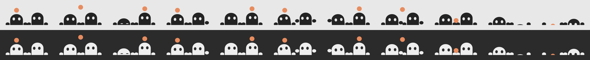

# Braincell

Two little peekers in your Mac's menu bar who share one braincell. They show up when you and
a friend are both mid-turn in Claude Code, act out what each of your Claudes is doing, and nap
when one of you stops.



## Install

Needs macOS 13 or later on Apple Silicon or Intel, the Xcode Command Line Tools with Swift 5.9
or later (`xcode-select --install`), and a recent Claude Code. Run on macOS 26 so far; the build
is also checked for macOS 13 and Intel.

On the first Mac:

```bash
git clone https://github.com/Aeronyx/braincell /tmp/braincell && /tmp/braincell/install.sh; rm -rf /tmp/braincell
```

It prints a pairing code. On the second Mac, install with that code:

```bash
git clone https://github.com/Aeronyx/braincell /tmp/braincell && /tmp/braincell/install.sh <pairing-code>; rm -rf /tmp/braincell
```

Everything is installed into `~/.braincell`, so nothing else is left behind. Run the same line
again any time to update; it keeps your code.

The installer compiles the app, adds its hooks to `~/.claude/settings.json` (next to any you
already have), and registers a login item. Claude Code sessions started after that count.

## What the twins do

Yours is on the left, your friend's on the right. Each acts out what its Claude is doing, in
short bursts with stillness in between:

| Claude is | The twin |
| --- | --- |
| thinking | gazes up |
| reading or searching files | sweeps its eyes along the lines |
| writing or editing | types with its paws |
| running commands | hops |
| browsing the web | looks all around |
| keeping a to-do list | tilts its head one way, then the other |
| running subagents | conducts with both paws |
| waiting on a permission prompt or a question | leans out and waves |

The braincell goes to whoever switched tasks most recently, and how it travels depends on the
work: a quick flat toss between busy hands, a weave while browsing, a high slow lob for planning.
When you're both doing the same kind of work it hovers between the twins and they move in
unison. If one Claude is waiting on its human the other twin gets it, and if both are waiting
it's set down on their joined paws.

They hop up from nowhere, in line with your other menu bar icons: paws first, then each head,
then the braincell. Whoever stops falls asleep where they are, hands the braincell over, and
wakes when their Claude starts again. Once someone has slept for five minutes they all leave the
way they came: the braincell drops away, the heads duck, and the paws let go last.

Click the twins (or hover) to read what each Claude is doing in a few words, such as "adding
custom widgets…". The words come from Claude's own to-do list and command descriptions, so they
cost no tokens.

## Remove

Click the twins and choose "Remove Braincell…", or run:

```bash
~/.braincell/uninstall.sh
```

That takes out the hooks, the login item, and `~/.braincell`.

## How it works

- **Hooks** ([hook](hook)) keep one small log per Claude Code session that is mid-turn, in
  `~/.braincell/busy/`: which tool is about to run and what Claude says it's for. Your prompts
  are never stored, and the hook never touches the network.
- **The app** ([Braincell.swift](Braincell.swift)) watches that folder. It posts to a private
  topic on [ntfy.sh](https://ntfy.sh) named after your pairing code, and holds one streaming
  connection to hear your friend's posts.
- **What leaves your Mac:** whether you're busy, the kind of work (one of the eight above), and
  up to about three words describing it. Set `shareWords` to `false` at the top of
  `Braincell.swift` and reinstall to keep the words to yourself. Anyone who knows the pairing
  code can read and send these, so treat it like a password.

## Good to know

- An interrupted turn (Esc) fires no hook, so it can count as busy for up to 10 minutes.
- Cloud sessions don't run local hooks, so only sessions on your Mac count.
- ntfy.sh allows 250 messages a day per person. Braincell sends one when you start or stop, one
  every 10 minutes while you're busy, and at most one a minute (120 a day) about what you're
  doing, so your friend's view of your activity can lag by up to a minute. To use your own ntfy
  server (HTTPS), install with `BRAINCELL_SERVER=https://ntfy.example.com ./install.sh <pairing-code>`
  on both Macs, then raise `detailEvery` and `detailBudget` if you like.
- Timings, the accent color, and the twins' proportions are constants at the top of
  `Braincell.swift`. `~/.braincell/Braincell --snapshot twins.png` renders the poses so you
  can check a change without waiting for your friend.
